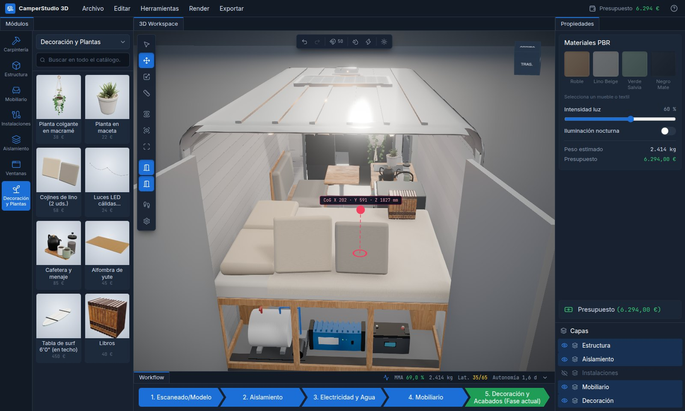
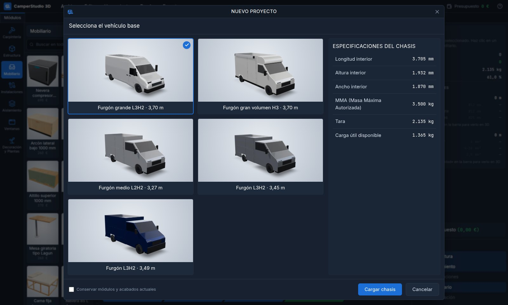
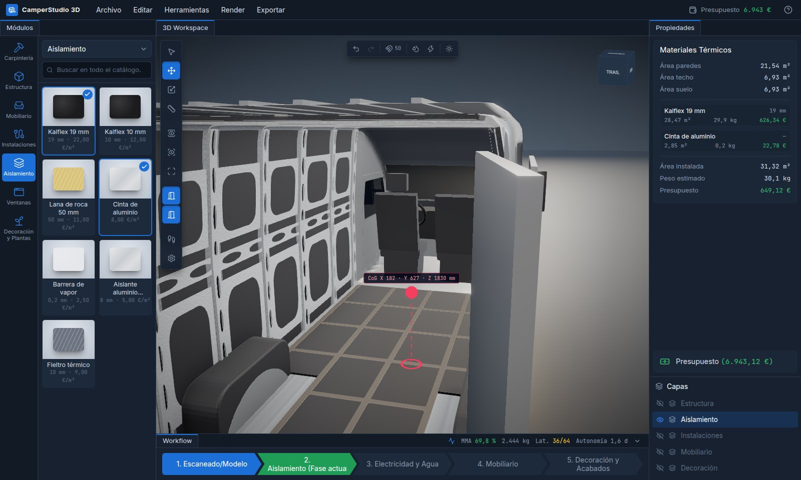
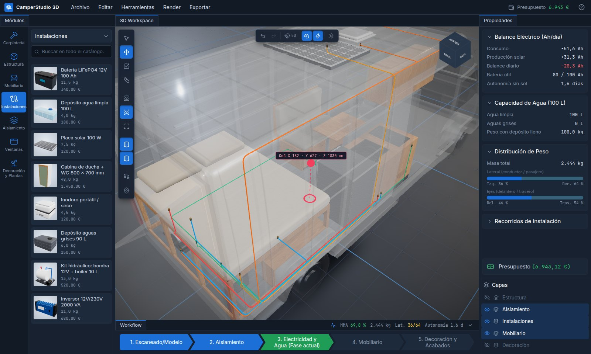
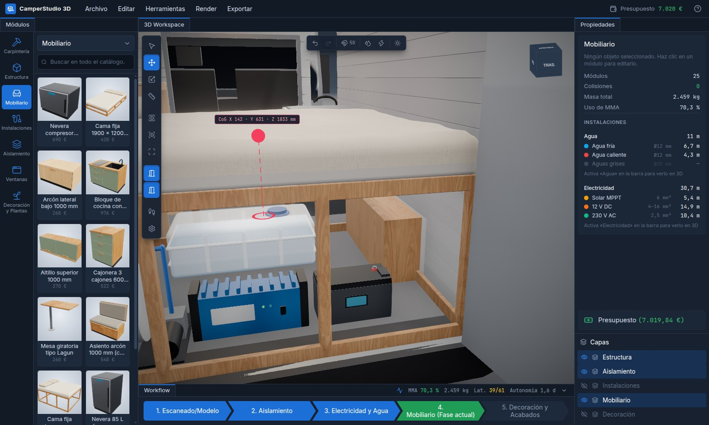
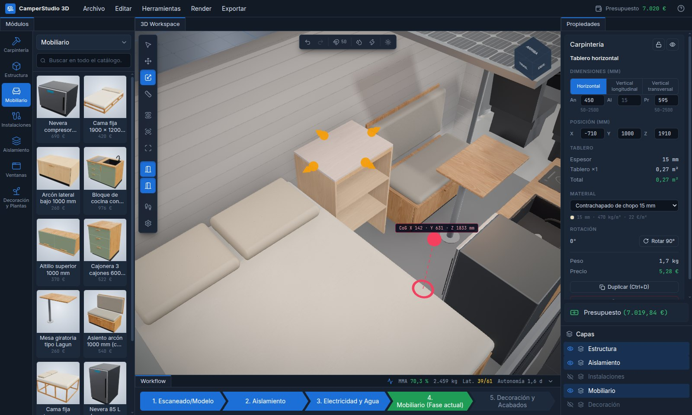
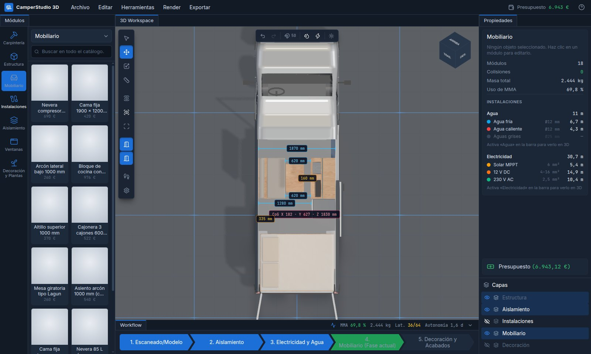
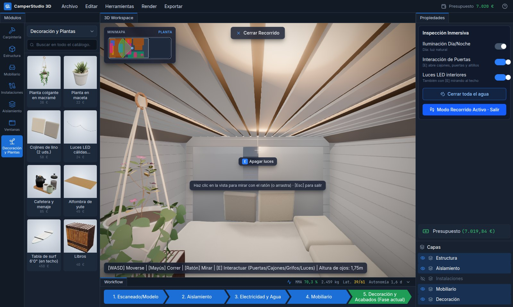
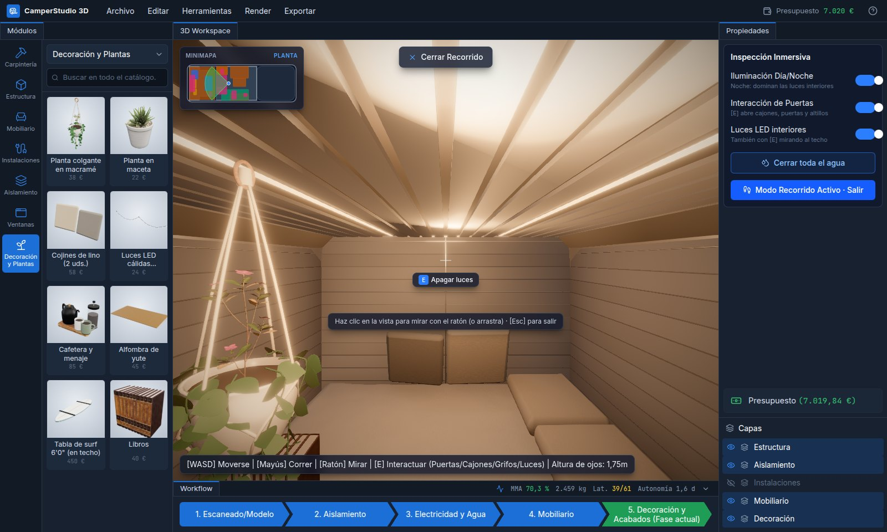

<div align="center">

# CamperStudio 3D

**Diseño paramétrico de camperizaciones en el navegador**

Distribuye el interior de tu furgoneta en 3D, comprueba pesos, centro de gravedad y energía en tiempo real, y recórrela en primera persona antes de cortar el primer tablero.




</div>

---

## Índice

- [Qué es](#qué-es)
- [Funcionalidades](#funcionalidades)
- [Flujo de trabajo por fases](#flujo-de-trabajo-por-fases)
- [Controles](#controles)
- [Puesta en marcha](#puesta-en-marcha)
- [Arquitectura](#arquitectura)
- [Documentación del proyecto](#documentación-del-proyecto)
- [Créditos de recursos](#créditos-de-recursos)
- [Aviso](#aviso)

## Qué es

**CamperStudio 3D** es un CAD ligero y especializado para camperizar furgonetas. Combina un editor 3D fotorrealista con un motor de ingeniería que, en cada cambio, recalcula:

- **Masa total y % de MMA** frente a la masa máxima autorizada del chasis.
- **Centro de gravedad** (X, Y, Z) y reparto lateral y entre ejes.
- **Balance eléctrico** (consumo, producción solar, autonomía) y **capacidad de agua**.
- **Presupuesto** de muebles, equipos, aislamiento y tableros.

Todo funciona en el navegador, sin servidor: el proyecto se guarda automáticamente en local, se puede guardar y abrir como archivo `.camper.json` y la lista de materiales se exporta a CSV.

## Funcionalidades

### Vehículos reales y nuevo proyecto

Elige el chasis base con sus cotas interiores reales, pasos de rueda, tara y MMA entre cinco furgones de referencia: L2H2, tres L3H2 de distintas longitudes (el grande con modelo 3D) y uno de gran volumen H3.



### Aislamiento por capas

Kaiflex, lana de roca, cinta de aluminio, barrera de vapor, aislante aluminizado y fieltro térmico sobre la chapa desnuda y su estructura de refuerzos. Áreas de paredes, techo y suelo, peso y coste calculados al instante.



### Instalaciones de agua y electricidad

Tuberías de agua fría, caliente y grises, y cableado solar, 12 V y 230 V trazados automáticamente entre los equipos, con longitudes y secciones. La carrocería pasa a rayos X para ver los recorridos.



### Muebles que se adaptan a la furgoneta

Las colisiones usan la **forma real de cada pieza**, no cajas invisibles. Camas, arcones y cocinas se **recortan sobre los pasos de rueda**, y baterías, inversores y depósitos se **alojan en el hueco** de la cama o del arcón sin marcar colisión. Al mover el mueble, lo que lleva dentro y encima viaja con él.



### Carpintería libre, tablero a tablero

Tableros horizontales y verticales y listones de pino de 40 × 40 mm. El grosor queda fijado por la madera elegida (chopo 15 mm, roble 18 mm, pino, abedul CPL, verde salvia). Con la herramienta **Redimensionar (R)** se estiran los cantos con el ratón: el canto opuesto queda fijo y el arrastrado se imanta a paredes, techo y otros tableros a 0 mm. Precio y peso por plancha real.



### Planta técnica con cotas

Vistas ortográficas de planta, lateral y trasera con cotas de pasillo y alturas libres, junto al resumen de módulos, colisiones, masa y metros de instalación.



### Recorrido en primera persona

Camina por el interior a la altura de los ojos (WASD + ratón) con minimapa. Con **E** abres cajones, puertas y altillos, abres el grifo o la ducha (agua animada) o enciendes las luces. Modo día y noche con iluminación LED cálida.

| Día | Noche |
| :---: | :---: |
|  |  |

### Y además

- **Render fotorrealista**: HDRI de estudio, materiales PBR con texturas fotográficas, oclusión ambiental (N8AO), bloom, tonemapping AgX y SMAA, con tres niveles de calidad.
- **Puertas de la furgoneta**: corredera lateral y portones traseros animados.
- **Decoración inteligente**: plantas, cojines, menaje, libros y alfombras se apoyan solos sobre la superficie que tienen debajo.
- **Edición precisa**: rejilla de 10 o 50 mm, imantación a paredes y caras, movimiento vertical, giros de 90°, bloqueo, visibilidad y capas.
- **Deshacer y rehacer** (100 pasos), con cada arrastre como un único paso.
- **Materiales y acabados** con recálculo de peso y precio.

## Flujo de trabajo por fases

El stepper inferior organiza el proyecto como en un taller real. Cada fase activa las capas que le corresponden:

| Fase | Qué haces |
| --- | --- |
| 1. Escaneado / Modelo | Eliges y revisas el chasis base. |
| 2. Aislamiento | Aplicas las capas térmicas sobre la chapa. |
| 3. Electricidad y agua | Colocas equipos y revisas los recorridos y el balance. |
| 4. Mobiliario | Distribuyes muebles y carpintería a medida. |
| 5. Decoración y acabados | Añades textiles, plantas, menaje e iluminación. |

## Controles

| Acción | Control |
| --- | --- |
| Girar la cámara | Botón izquierdo |
| Desplazar la vista | Botón central o derecho |
| Zoom | Rueda |
| Seleccionar / Mover / Redimensionar | `V` / `G` / `R` (de nuevo `R` vuelve a Mover) |
| Deshacer / Rehacer | `Ctrl+Z` / `Ctrl+Y` o `Ctrl+Shift+Z` |
| Duplicar pieza | `Ctrl+D` |
| Guardar proyecto | `Ctrl+S` |
| Recorrido: andar / correr | `W A S D` / `Mayús` |
| Recorrido: interactuar / salir | `E` / `Esc` |

## Puesta en marcha

Requisitos: **Node.js 20.19+ o 22.12+** y un navegador con WebGL 2.

```bash
git clone https://github.com/markel3/van_camper_3D.git
cd van_camper_3D
npm install
npm run dev
```

| Script | Descripción |
| --- | --- |
| `npm run dev` | Servidor de desarrollo con recarga en caliente. |
| `npm run build` | Comprobación de tipos y build de producción en `dist/`. |
| `npm run typecheck` | Solo comprobación de tipos (TypeScript estricto). |
| `npm run preview` | Sirve el build de producción. |
| `node scripts/capture-thumbnails.mjs` | Regenera las miniaturas del catálogo con Chromium sin interfaz. |

## Arquitectura

| Capa | Tecnología |
| --- | --- |
| Interfaz | React 19, Tailwind CSS 4, lucide-react |
| 3D | three.js r186, React Three Fiber 9, drei 10, @react-three/postprocessing |
| Estado | Zustand 5 + Immer + zundo (historial de deshacer) |
| Build | Vite 8, TypeScript estricto |

```text
src/
├── components/
│   ├── canvas/      Escena 3D: furgoneta, props procedurales, instalaciones, agua,
│   │                render, recorrido en primera persona, gizmos y tiradores
│   └── layout/      Interfaz: barra de menús, catálogo, propiedades, flujo y modales
├── data/            Catálogos: vehículos, módulos, decoración, carpintería, materiales
├── store/           Estado del proyecto (con historial), de la vista y de interacción
├── utils/           Motor puro: colisiones, formas, adaptación, CoG, energía, precios
├── hooks/           Métricas de ingeniería y atajos de teclado
└── types/           Tipos del dominio
```

El motor de ingeniería (`src/utils`) es TypeScript puro, sin React, y comparte con la escena 3D la definición de cada pieza. Así, lo que choca es exactamente lo que se ve.

## Documentación del proyecto

| Documento | Contenido |
| --- | --- |
| [PROJECT_OVERVIEW.md](PROJECT_OVERVIEW.md) | Visión de producto y pilares funcionales. |
| [ARCHITECTURE.md](ARCHITECTURE.md) | Estructura técnica y patrones de diseño. |
| [WORKFLOWS.md](WORKFLOWS.md) | Lógica matemática: colisiones, imantación, pesos, CoG y energía. |
| [ROADMAP.md](ROADMAP.md) | Hoja de ruta. |
| [AGENTS.md](AGENTS.md) | Roles del equipo de desarrollo asistido por IA. |

## Créditos de recursos

- Texturas PBR, HDRI de estudio y modelos de decoración de [Poly Haven](https://polyhaven.com) y [ambientCG](https://ambientcg.com), con licencia **CC0**. El detalle está en [`public/models/decor/CREDITS.md`](public/models/decor/CREDITS.md).
- Iconos de [Lucide](https://lucide.dev).

## Aviso

Las masas, precios, consumos y dimensiones del catálogo son **valores de referencia aproximados**. Antes de usarlos en un proyecto real o en un informe de homologación, contrástalos con las fichas técnicas de cada fabricante y proveedor.
